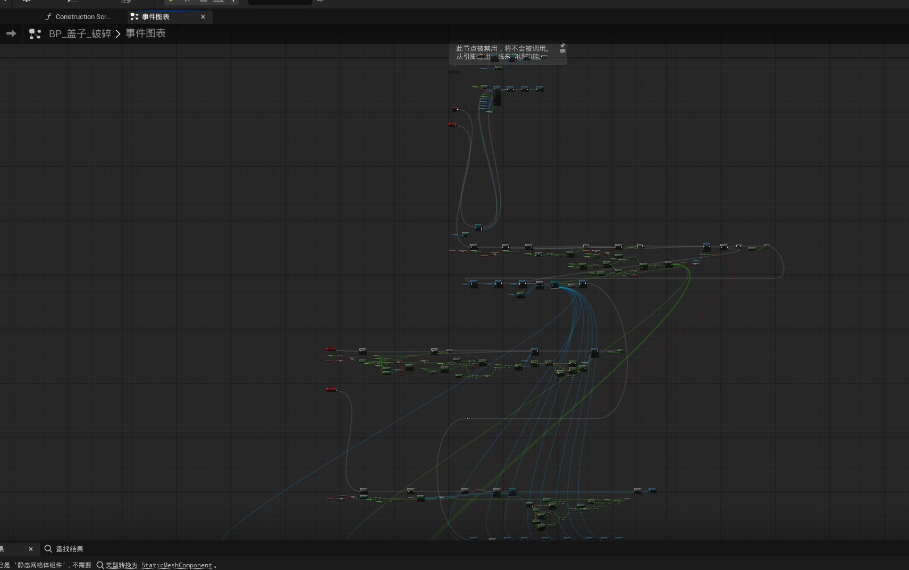
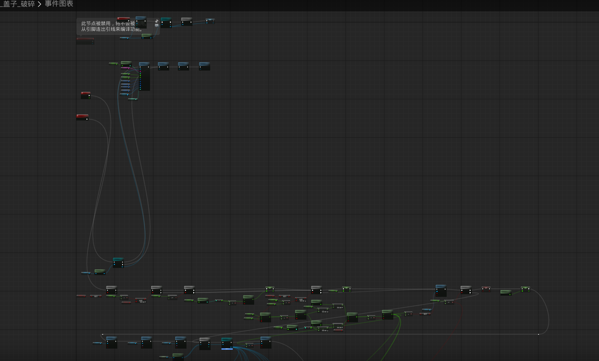
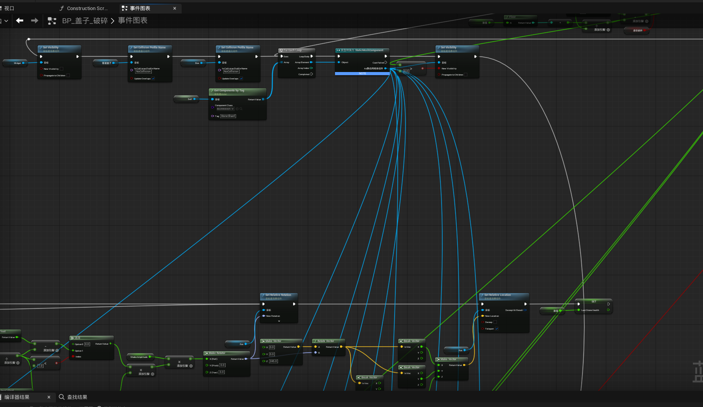

# 修改记录

## 2026-11-23 · 蓝图多轮修改后排版退化

**状态：待修。** 案例来自 Windows UE 5.8.4 的破碎盖子蓝图。功能在 PIE 中通过验证，但反复修改后，EventGraph 出现长距离折返、执行线离开所属行、共享数据线跨区。安装描述符显示 `0.6.0`，它不能唯一定位 Windows 二进制对应的提交。本文记录现场现象；当前 `main` 是否仍能复现，需要用同一夹具复测。

### UE 现场截图

按「全图 → 执行线 → 数据线」看，能同时定位问题区域和连线两端。以下为同一蓝图的 8 张现场原图。

*截图 04：事件图全景，多个区域由纵向长线和斜线连接。*

*截图 01：事件入口与下方执行链之间的长距离折返。*

*截图 08：多个蓝色数据输出跨区连接下方消费者。*

**原图索引**

- [截图 01 · 事件入口与下方执行链之间的长距离折返](assets/2026-11-23-blueprint-layout-01.png)

- [截图 02 · 中段多条数据线跨行汇入](assets/2026-11-23-blueprint-layout-02.png)

- [截图 03 · 执行线大弧度回绕与下游纯数据区](assets/2026-11-23-blueprint-layout-03.png)

- [截图 04 · 事件图全景，多个区域由纵向长线和斜线连接](assets/2026-11-23-blueprint-layout-04.png)

- [截图 05 · 中段细节，白色执行线跨越相邻节点组](assets/2026-11-23-blueprint-layout-05.png)

- [截图 06 · 纯数据计算区，绿线和黄线跨列交叠](assets/2026-11-23-blueprint-layout-06.png)

- [截图 07 · 同一区域的横向执行链与纵向数据线交叉](assets/2026-11-23-blueprint-layout-07.png)

- [截图 08 · 多个蓝色数据输出跨区连接下方消费者](assets/2026-11-23-blueprint-layout-08.png)

### 现象与触发方式

同一张图先调用 `write_graph_from_code` 整段改写已有自定义事件，多次写入没有携带未改节点的 ID。然后用 `edit_graph batch` 分别接入数字 UI、摇摆、清理，部分后续操作只改引脚。一次现场快照读到 **281 个节点、358 条连接**，其中 `UpdateStone` 的执行链和上游数据依赖涉及约 **156 个节点**。这些数字是阶段快照，后续改逻辑会变动。

| 连接 | 两端节点纵坐标差 |
| --- | ---: |
| Tick → UI 类型转换 | 约 2,204 |
| UI 类型转换 → 设置文本 | 约 2,601 |
| UpdateStone 入口 → 第一处分支 | 约 2,278 |

这些是图表坐标差，便于建立回归指标。编译成功、PIE 行为正常与排版质量分别验收。

### 源码原因

1. **旧入口与新事件体的排版范围不对称。** `McpGraphCodeWriteForm.cpp` 的 Pass 0 保留已有事件入口，替换的旧体加入忽略集合，未保留的节点作为新增节点参与排版。没有保留链路节点时，`bAllowMovingExisting` 关闭，周边固定区域限制新执行链的候选空间。反复整段重写因此可能反复把新体挤离入口。
2. **纯接线和增量插入缺少完整的受影响范围。** `McpBPGraphBatchPlacement.cpp::LayoutAutoPlacedNodes` 从 `AutoPlacedGuids` 收集新节点。重新连接旧节点时，旧的上游、下游与分支汇合点可能仍保持旧坐标。显式 `arrange_nodes` 可以指定范围，但调用者必须自行找齐执行链和数据依赖。
3. **大事件体放大问题。** 伤害曲线、逐块计算、释放和径向冲量堆在同一个事件，纯节点扇出高，局部靠近一个消费者时仍会拉长其他消费者的连线。此次操作也应优先复用节点 ID，小批次连线后读回几何，并把进度计算和单块释放提成函数。

对照入口：`Source/EngineWire/Private/Domains/BlueprintGraph/Code/McpGraphCodeWriteForm.cpp`、`McpBPGraphBatchPlacement.cpp`、`McpBPGraphDeleteNodes.cpp`、`Source/EngineWire/Private/Foundation/GraphLayout/McpRuled.cpp`。已有 [PR #13](https://github.com/dadaozei01/enginewire/pull/13)、[PR #15](https://github.com/dadaozei01/enginewire/pull/15)、[PR #16](https://github.com/dadaozei01/enginewire/pull/16) 分别涉及真实节点与引脚几何、写入分区和纯 DAG 排版。应先从当前源码构建复现，再按仍存在的失败项修改。

### 插件修改建议

1. **先补多轮写入回归夹具。** 用最小事件图复刻「Tick → Cast 分两路 → 汇合 → 自定义事件」，事件体加循环和跨分支共享的纯数据。连续执行三轮：整段替换无 ID、保留 ID 的链内插入、只改已有节点连线。增加一个旁路事件和手工布局节点作为保护样本。每轮记录入口到首个节点的执行引脚高差、长执行线数量、节点交叠及无关节点位移。
2. **把拓扑变化纳入局部排版。** 在 `edit_graph batch` 收集创建、改线、断线的端点以及被替换的旧连接。沿执行链扩到最近分支或汇合点，吸纳这段链路独占的纯数据节点。把同一区域交给 `McpRuled` 一次排版。保留入口与无关事件锚点，并提供显式关闭局部复排的选项。
3. **整段替换优先继承旧事件的布局空间。** 在删除旧体前记录旧区域和入口行。新执行节点优先接在入口右侧同一行，以最小位移给相关下游腾位置。候选空间不足时返回具体受限区域，并允许显式整理该事件，而不是静默留下长距离折返。
4. **为共享数据和回线设置可验证的边界。** 优先复用已合入的真实引脚几何、纯 DAG 和读取节点就近复制逻辑。对不可安全复制的共享计算保留语义，用有界的走线通道组织长线。首次排版后再跑一次应近似幂等，GUID、连线语义和无关区域位置应保持稳定。

### 复测交接

记录 UE 版本、构建提交和二进制 SHA-256。在 Win64 用相同夹具跑三轮操作，保存每轮节点坐标、编译结果与前后截图。若可以缩小到某一路径，只修该路径。实际项目蓝图作为手动复核样本，仓库只保留可公开的图表截图与说明。
